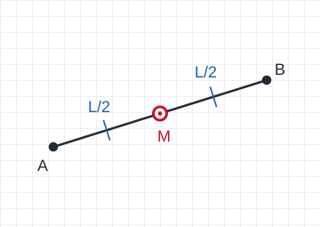
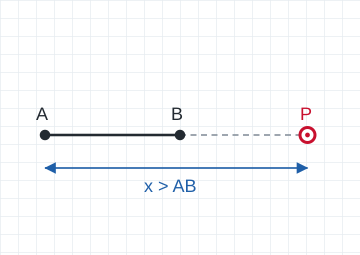
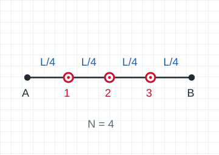
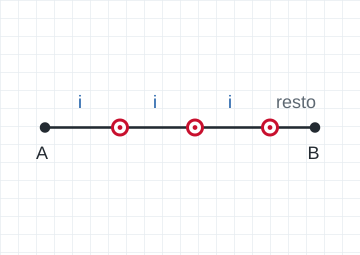
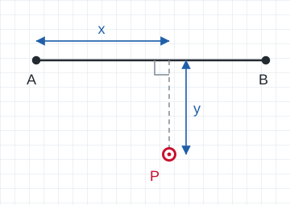
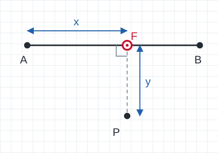
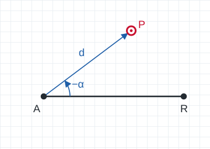
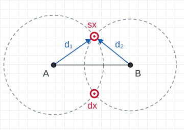

# COGO linea A-B — plugin per QField

Plugin per [QField](https://qfield.org) che calcola nuovi punti partendo da due punti già rilevati, A e B: punto medio, divisioni, prolungamenti, scostamenti, intersezioni.

Le distanze sono **orizzontali al suolo**, come quelle misurate con il nastro o il distanziometro. Il plugin non usa le distanze della proiezione cartografica. Per questo i punti tracciati in campagna coincidono con le misure fatte sul terreno, senza l'errore di scala della proiezione: in UTM, nel Nord Italia, l'errore può arrivare a circa 2 cm ogni 100 m.

*English summary at the end of the page.*

## Operazioni

| Schema | Operazione | Parametri | Risultato |
|---|---|---|---|
|  | **Punto medio** | — | 1 punto |
|  | **Distanza x da A** / **da B** | x; può essere negativa o andare oltre l'altro estremo (prolungamento) | 1 punto |
|  | **Divisione in N parti** | N intero ≥ 2 | N−1 punti |
|  | **Un punto ogni x m** da A / da B | passo | punti a passo fisso; viene indicato il resto |
|  | **Progressiva e scostamento** | x da A, y (positivo a destra di A→B) | 1 punto |
|  | **Piede della perpendicolare da P** | punto P, toccato sulla mappa | piede su AB, con progressiva e scostamento di P |
|  | **Angolo e distanza da A** | α dalla direzione A→B, in senso orario (negativo = antiorario); distanza d | 1 punto |
|  | **Intersezione distanza-distanza** | d₁ da A, d₂ da B, soluzione a destra o a sinistra di A→B | 1 punto; segnala se l'angolo d'intersezione è sfavorevole (fuori da 54°–126°) |

Ogni operazione calcola al massimo 1000 punti.

Il plugin misura α in senso orario, come gli azimut. Nello schema "Angolo e distanza" l'angolo è antiorario ed è quindi indicato come −α: per ottenere quel punto P bisogna inserire un valore negativo.

## Installazione

1. Scarica lo zip `cogo_linea-vX.Y.Z.zip` dalla pagina [Releases](../../releases).
2. In QField apri **Impostazioni → Plugin** e installa il plugin dallo zip, oppure dall'indirizzo dello zip.
3. Attiva il plugin. Nella barra degli strumenti compare il pulsante *COGO linea A-B*.

In alternativa puoi copiare a mano la cartella `cogo_linea/` nella cartella dei plugin di QField:

- su Windows: `Documenti\QField Documents\QField\plugins\`;
- su Android: `QField/plugins/`.

## Uso

1. Nella legenda scegli come **layer attivo** il layer dei punti rilevati.
2. Apri il pannello con il pulsante del plugin. Per spostarlo, trascinalo da un punto libero.
3. Premi **A** e tocca il punto sulla mappa, poi fai lo stesso per **B**. Viene scelto il punto del layer attivo più vicino al tocco, entro 15 pixel. Non serve entrare in modalità di digitalizzazione.
4. Scegli l'operazione e inserisci i parametri (la virgola decimale va bene), poi premi **Calcola**. I punti compaiono in anteprima.
5. **Salva** scrive tutti i punti nel layer `cogo_point`, in un'unica operazione: o vengono salvati tutti, o nessuno.

### Configurazione

Per aprire la configurazione hai due modi: il pulsante di configurazione nel gestore plugin di QField, oppure una **pressione lunga** sul pulsante del plugin.

- **Unità degli angoli**: gradi sessadecimali (predefinita), sessagesimali (`12 34 56.7` oppure `12°34'56.7"`) o centesimali (gon).
- **Quota del layer**: indica, per ciascun layer di rilievo, da dove prendere la quota e di che tipo è.
  - Da dove: la Z della geometria oppure un campo della tabella.
  - Tipo: **ortometrica H** oppure **ellissoidica h**.

  Se non imposti nulla, vale *Z della geometria, ortometrica*.

## Come vengono calcolati i punti

- **Il calcolo.** Ogni operazione porta i punti su un **piano topocentrico locale (ENU)** con origine nel punto A, fa il calcolo e riporta i risultati nel sistema di riferimento del layer. I dati restano nel loro sistema di riferimento: non serve configurare nessun sistema personalizzato.
- **Precisione.** Su 1 km la distanza ENU coincide entro 0,5 mm con la distanza geodetica ridotta alla quota media.
- **Grigliato del geoide.** Se in QField è impostato un grigliato del geoide (Impostazioni → Posizionamento), il plugin ne legge l'ondulazione N₀ nell'origine. Se il grigliato non è impostato, N₀ = 0. Anche un errore di 1 m su N₀ cambia le distanze di appena 0,16 ppm.
- **La quota dei punti calcolati.**
  - È dello **stesso tipo** di quella di A e B (ortometrica o ellissoidica).
  - Lungo il segmento AB è **interpolata** linearmente. Fuori dal segmento è quella dell'estremo più vicino.
  - Se A o B non hanno quota, i punti calcolati risultano con quota "da assegnare".
- **Convenzioni.**
  - Gli scostamenti sono **positivi a destra** della direzione A→B.
  - Gli azimut sono misurati dal Nord, in senso orario, e riferiti al Nord dell'origine.

## Il layer `cogo_point`

Il plugin salva i punti nel layer `cogo_point`:

- se il layer è già nel progetto, usa quello;
- altrimenti carica `cogo_point.gpkg` dalla cartella del progetto;
- se manca anche il file, lo crea (PointZ, con il sistema di riferimento del layer di rilievo).

| Campo | Contenuto |
|---|---|
| `descrizione` | descrizione leggibile, ad esempio `a 10.000 m da B (25) verso A (24)` |
| `operazione` | codice dell'operazione: `medio`, `dist_A`, `dist_B`, `div_N`, `passo_A`, `passo_B`, `prog_off`, `piede_P`, `ang_dist`, `dist_dist` |
| `parametro` | il parametro principale: x, N, passo, α o d₁ |
| `scostamento` | scostamento da AB, positivo a destra |
| `fid_A`, `fid_B` | identificativi dei punti A e B nel layer di rilievo |
| `progressiva` | distanza al suolo da A |
| `quota_tipo` | come è stata ottenuta la quota: `interpolata`, `da A/B (fuori segmento)`, `da assegnare` |
| `quota_rif` | tipo della Z: `H ortometrica` o `h ellissoidica` |
| `H_elliss`, `Q_geoide` | quota ellissoidica h e quota ortometrica H. La seconda è valorizzata solo se in QField è impostato un grigliato |
| `n0` | ondulazione N del grigliato nel punto |
| `gruppo` | codice comune a tutti i punti salvati con lo stesso **Salva**, ad esempio `div_N_1760346612345` |
| `data` | data e ora del salvataggio, in UTC |

Il campo `gruppo` serve in QGIS per:

- selezionare o eliminare in blocco i punti di una stessa operazione;
- unirli in una linea con *Da punti a linea*, raggruppando per `gruppo` e ordinando per `progressiva`.

## Requisiti

- QField 4.x.
- Un layer di punti rilevati, meglio se in RTK fixed.

## Test della libreria di calcolo

Con [Node.js](https://nodejs.org) 18 o successivo:

```
node test/test_cogo_enu.js
```

## Licenza

GPL-2.0, come QField. Vedi [LICENSE](LICENSE).

---

## English summary

**COGO linea A-B** is a QField plugin that computes new points from two surveyed points A and B, using **horizontal ground distances**. The computation is done on a local topocentric (ENU) plane, not with grid distances in the map projection.

Operations:

- midpoint;
- point at distance x from A or B (including extension beyond the segment);
- division into N parts;
- points at a fixed interval;
- chainage and offset;
- foot of the perpendicular from P;
- angle and distance from A;
- distance-distance intersection.

Results are saved to a `cogo_point` layer, with metadata about the operation and how heights were derived (orthometric or ellipsoidal, interpolated, geoid undulation). The user interface is in Italian.

To install, download the zip from [Releases](../../releases) and install it from QField's plugin manager.
